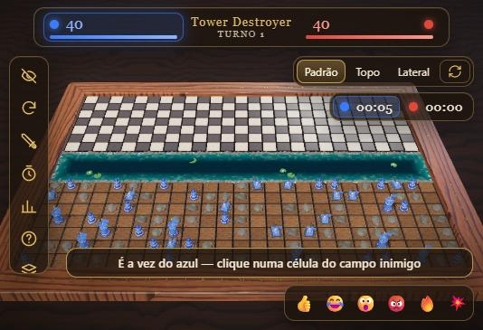

# Riverfront

Batalha por turnos em tabuleiro 3D, direto no navegador. Dois campos escondidos, um rio no meio e uma pergunta: onde o inimigo se escondeu?

Riverfront é o sucessor do [Tower_Destroyer2D](https://github.com/gkamchen/Tower_Destroyer2D), meu TCC de faculdade feito há seis anos em C# e nunca terminado. Esta versão é um recomeço do zero: nova linguagem, regras repensadas e visual 3D com animações.

## Jogue a demo

**[gkamchen.github.io/Riverfront](https://gkamchen.github.io/Riverfront/)**

A demo atual é o protótipo visual: tabuleiro 3D, câmera, animações de tiro e explosão, contra um bot simples. O nome dentro do jogo ainda aparece como "Tower Destroyer" (nome provisório).

## Evolução

| Marco | Estado |
|---|---|
| Protótipo visual 3D (tabuleiro, rio, explosões, HUD) | publicado |
| Motor de regras: peças com formas, posicionamento, tiro extra, habilidades | em desenvolvimento |
| Bots com 5 níveis e personalidades | em desenvolvimento |
| Rio vivo (peixes, garça, sapos) e novos temas de mundo | em desenvolvimento |
| Partida online 1 contra 1 por link e amizades | planejado |
| Skins, conquistas, campanha e desafio diário | planejado |

## Tecnologias

TypeScript, Three.js e Vite. Todos os gráficos e sons são gerados por código, sem arquivos de terceiros.

## Licença

Todos os direitos reservados. Veja [LICENSE](LICENSE). Você pode jogar a demo e ver o repositório, mas o código-fonte do jogo não é aberto.
