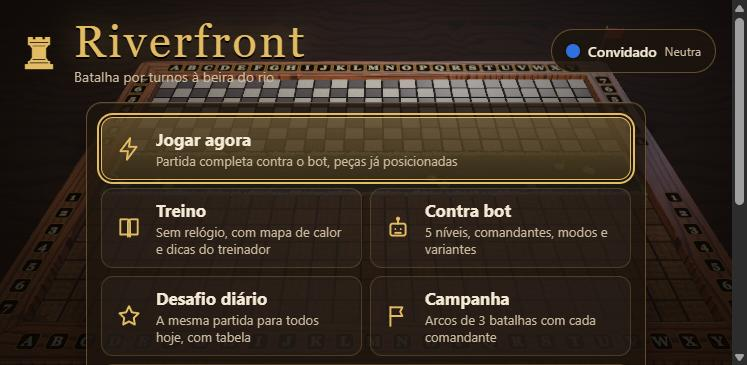
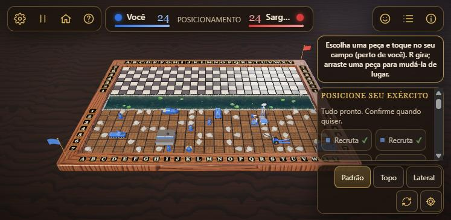

# Riverfront

Jogo de batalha por turnos em 3D, no espírito do Batalha Naval, com cara de tabuleiro clássico: moldura de madeira envernizada, peças com formas, um rio vivo entre os dois campos e câmera inclinada.

Riverfront é o sucessor do [Tower_Destroyer2D](https://github.com/gkamchen/Tower_Destroyer2D), o meu TCC de faculdade, feito há seis anos em C# e nunca terminado. Esta versão é um recomeço do zero, em TypeScript, com regras novas, visual 3D animado e partidas online.

**[Jogue a demo no navegador](https://gkamchen.github.io/Riverfront/)**




Cada jogador (ou cada dupla) tem um campo de **25 × 7** células (15 × 5 nos modos rápidos), separados por um rio. Antes da batalha você posiciona o seu exército: recrutas, blindados, artilharia, bunker, antena e outras peças, cada uma com o seu formato e as suas regras. Depois, na sua vez, escolhe uma célula do campo inimigo: ela vira e mostra terra, rocha ou parte de uma unidade. Acertar dá tiro extra. No modo completo há energia, cinco habilidades (radar, bombardeio, escudo, reparo e espião) e o tiro especial da sua facção. Vence quem destruir primeiro todas as unidades do outro lado.

## Como rodar

Requer Node.js 20 ou mais recente.

```bash
npm install
npm run dev      # cliente em http://127.0.0.1:5173
npm run server   # servidor online na porta 8787 (rode npm run build antes)
npm test         # regras, bots, cliente, protocolo e servidor
npm run sim      # liga de bots: 200 partidas por confronto
npm run build    # checagem de tipos + build de produção de tudo
```

Para jogar online na rede local, rode `npm run build` e `npm run server`: o próprio servidor entrega o jogo em `http://<ip>:8787/`. O app de desktop (`npm run desktop`) tem "Hospedar partida". Detalhes em [docs/online.md](docs/online.md) e [docs/distribution.md](docs/distribution.md).

## Modos

| Modo | O que é |
| --- | --- |
| Jogar agora | Partida contra o bot com o exército já posicionado (dá para mexer antes de confirmar) |
| Treino | Bot gentil, sem relógio, com mapa de calor e explicações do treinador |
| Contra bot | 5 níveis (Cabo Pipoca a General Abismo), comandante adversário, sua facção, modo, relógio e variantes |
| Duplas | 2 contra 2 com bots: você e um parceiro dividem o campo, a energia e as informações; online também |
| Desafio diário | A mesma partida para todos no dia (semente, modo, facções, variantes e bot), com pontuação e tabela |
| Campanha | Um arco de 3 batalhas por comandante, com mutador assinatura, estrelas e desbloqueio por ondas |
| 1x1 online | Sala por link ou código, perfil com apelido#etiqueta e cor, amigos, emojis e provocações, revanche |
| Desafiar amigo | Convite direto para alguém da lista de amigos online |

Presets de regras: **Clássico** (sem poderes), **Completo** (energia, habilidades e facções), **Rápido** e **Rápido com poderes** (campo menor, turnos curtos). Variantes: maré, tiro duplo e neblina. Relógio por turno (relâmpago 10 s, padrão 30 s, tranquilo 60 s ou sem limite), com avisos aos 10 e aos 5 segundos; estourar o tempo pula o turno e conta uma falta.

## Facções

São 23 facções em quatro ondas (ver o [roadmap](docs/ROADMAP.md)), cada uma com arquétipo (informação, defesa, ataque, tempo ou energia), tiro especial, comandante com retrato e falas, rio, peças e sons próprios. A primeira onda traz **Egípcios** (sonda e radar que vê anfíbios), **Romanos** (testudo e tiro certeiro) e **Gregos** (rajada e torre automática). O seletor mostra todas, filtradas por onda e arquétipo, com o selo pronta ou em breve. Todas têm o mesmo orçamento de poder, medido pela liga de bots.

## Controles

| Ação | Mouse / toque | Teclado |
| --- | --- | --- |
| Posicionar uma peça | toque na peça da bandeja e depois no seu campo; arraste para mover | setas + Enter, R gira |
| Atacar | clique (no toque: toque e confirme em "Disparar") | setas para mirar, Enter ou Espaço |
| Habilidade / tiro especial | botões no canto da tela, depois o alvo | Esc cancela |
| Girar a câmera / zoom | arrastar / roda ou pinça | — |
| Vistas | botões Padrão, Topo, Lateral e "modo mira" | 1, 2, 3 |
| Pausar (contra o bot) | botão de pausa | P |
| Som, ajuda | engrenagem, botão de ajuda | M, H |

Tudo o que é ajuste fica na engrenagem: tema, qualidade (automática por padrão), coordenadas, som, idioma (português e inglês), cores para daltonismo, movimento reduzido, confirmação de disparo e atalhos de uma tecla. A interface está descrita em [docs/ui.md](docs/ui.md).

## Estrutura

```
packages/
  core/      regras puras em TypeScript (sem DOM, sem three.js); ver packages/core/README.md
  ai/        cinco bots, comandantes e o treinador, só com a visão pública; ver packages/ai/README.md
  protocol/  mensagens, cores, emotes e limites do modo online
  server/    servidor autoritativo (WebSocket), contas anônimas, salas e amigos
  client/    aplicação Three.js + Vite
    src/
      app/        controlador da partida, modos, posicionamento e ligação cena/HUD
      hud/        interface HTML/CSS, menus, textos (pt/en) e sobreposição do tabuleiro
      net/        sessão online, partida remota e painel online
      board/      moldura, células, rio e vida selvagem
      units/      as peças de cada papel
      factions/   facções: kits de peças, retratos e temas
      effects/    partículas, explosões, fogos e chuva
      camera/     câmera orbital com vistas e tremor
      materials/  texturas procedurais e temas
      scene/      renderizador, luzes e qualidade
      audio/      sons sintetizados com WebAudio
  desktop/   app Electron com "Hospedar partida"
```

O `core` guarda os dois campos e só entrega a cada jogador o que ele pode ver. Local ou online, o cliente anima a partida a partir do histórico público da visão, então as duas formas de jogar passam pelo mesmo código.

Nenhum arquivo de modelo, textura, fonte ou áudio é baixado: tudo é gerado em código na hora.

## Licença

O código é público sob a [PolyForm Noncommercial 1.0.0](LICENSE) © 2026 Gustavo Kamchen.

- Você pode ler, estudar, fazer fork, modificar e usar o Riverfront **sem fins comerciais** (uso pessoal, estudo, pesquisa, escolas, entidades sem fins lucrativos).
- **Uso comercial** (vender, cobrar acesso, hospedar como serviço pago, embutir em produto comercial) exige permissão por escrito do autor: gkamchen@gmail.com.
- O texto que vale é o da licença em [LICENSE](LICENSE); este resumo não a substitui.
